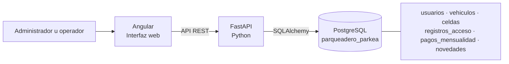
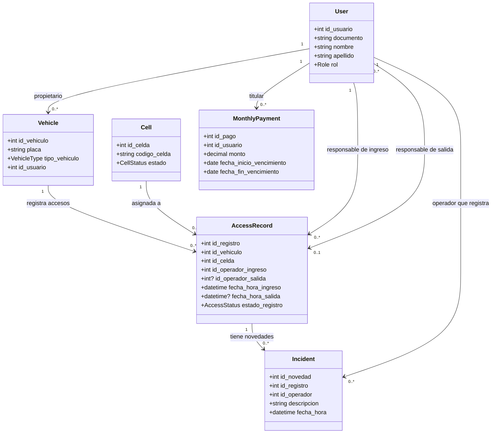

# PARKEA

Aplicación inicial de gestión de parqueadero con **Angular**, **FastAPI (Python)** y **PostgreSQL**. Incluye control de accesos con mensualidad vigente, mapa de celdas, usuarios y roles, vehículos, pagos e incidentes.

## Estructura

```text
parkea_app/
├── backend/                 # API FastAPI, modelos y autenticación
│   ├── scripts/              # Alta segura del primer administrador
│   ├── src/main.py           # Endpoints REST
│   ├── src/services/         # Reglas transaccionales de negocio
│   └── test/
├── database/schema.sql       # Esquema PostgreSQL e inicialización de celdas
├── frontend/                 # Aplicación Angular
└── docker-compose.yml        # PostgreSQL 16 para desarrollo local
```

## Arquitectura



## Trazabilidad de requisitos, historias y prototipo

Las historias originales HU-01 a HU-05 conservan su numeración. HU-06 completa la trazabilidad pendiente de gestión de usuarios.

| Requisito | Historia | Cobertura |
|---|---|---|
| RF-01 Registro de ingreso de vehículos | HU-01 | Registrar ingreso, validar mensualidad y asignar una celda compatible |
| RF-02 Registro de salida de vehículos | HU-02 | Finalizar el acceso, calcular permanencia y liberar la celda |
| RF-03 Gestión de usuarios | HU-06 | Registrar, consultar y actualizar usuarios y roles |
| RF-04 Gestión de celdas | HU-03 | Consultar disponibilidad y administrar estados |
| RF-05 Gestión de pagos de mensualidad | HU-05 | Registrar pagos y extender vigencia |
| RF-06 Registro de novedades | HU-04 | Asociar observaciones a una estancia y a su operador |

### HU-06 — RF-03: Gestión de usuarios

**Historia:** Como administrador, quiero registrar, consultar y actualizar usuarios, diferenciando los roles Administrador, Operador y Cliente, para mantener las cuentas y sus permisos al día.

- **Precondiciones:** el administrador inició sesión; el documento identifica de forma única a cada usuario.
- **Flujo principal:** registra una cuenta con documento, nombre, apellido, datos de contacto y rol; para administrador u operador también solicita contraseña. Los clientes no pueden iniciar sesión. El administrador puede consultar, editar, desactivar y reactivar cuentas.
- **Criterios de aceptación:**
  1. Al registrar datos válidos se crea una cuenta con el rol indicado; las contraseñas asignadas se almacenan de forma segura.
  2. Al abrir el directorio se consultan los usuarios con sus roles y estados.
  3. Al actualizar o reactivar una cuenta, el directorio refleja los datos guardados; una contraseña vacía no reemplaza la existente. Reactivar un cliente no habilita su inicio de sesión.
  4. Un documento duplicado, un usuario inexistente o una actualización no autorizada produce un error explícito y no guarda cambios.

### HU-01 — RF-01: Registro de ingreso

**Historia:** Como operador, quiero registrar la entrada de un vehículo ingresando su placa y asignando una celda, para controlar la ocupación y validar la mensualidad vigente.

- **Aceptación:** dado un vehículo de un cliente activo con mensualidad vigente y una celda disponible compatible, cuando el operador confirma la entrada, entonces se registra el ingreso, el responsable y la hora, y la celda pasa a OCUPADA.
- **Rechazos:** una mensualidad vencida o inexistente, un vehículo que ya está dentro o la falta de una celda compatible impide el ingreso y muestra el motivo sin crear otro registro ni alterar la ocupación.

### HU-02 — RF-02: Registro de salida

**Historia:** Como operador, quiero registrar la salida de un vehículo por su placa, para cerrar el acceso, calcular su permanencia y liberar la celda.

- **Aceptación:** dado un ingreso activo, cuando el operador confirma la salida, entonces el sistema guarda la hora y el responsable, finaliza el acceso, calcula y muestra la permanencia, y actualiza la lista operativa.
- **Rechazo:** si la placa no tiene ingreso activo, el sistema informa el error y no modifica ningún registro ni celda; una salida ya finalizada no puede repetirse.

### HU-03 — RF-04: Control y mapa de celdas

**Historia:** Como operador o administrador, quiero visualizar el estado de las celdas y enviarlas a mantenimiento, para gestionar la disponibilidad de espacios.

- **Aceptación:** al abrir el mapa, cada celda muestra su tipo y estado con una leyenda consistente: verde para DISPONIBLE, ámbar para OCUPADA y rojo para MANTENIMIENTO.
- **Regla de mantenimiento:** el operador o administrador puede enviar una celda disponible a mantenimiento o programarlo para una celda ocupada; al registrar la salida permanece en MANTENIMIENTO y no vuelve a ofrecerse hasta que un administrador la habilite.

### HU-05 — RF-05: Gestión de pagos

**Historia:** Como administrador, quiero registrar los pagos mensuales de los usuarios, para actualizar su vigencia de acceso.

- **Aceptación:** dado un cliente, cuando se registra un pago válido con monto, duración y método, entonces el sistema muestra el resultado y las fechas de vigencia actualizadas en el historial.
- **Rechazo:** un monto no positivo, una duración inválida o un cliente inexistente muestra el error y no agrega un pago.
- **Consulta operativa:** el administrador y el operador pueden seleccionar un cliente para consultar su historial completo de pagos y de entradas y salidas. También pueden ver los clientes sin mensualidad vigente hoy, incluidos quienes tienen pagos vencidos, futuros o ninguno. La lista incluye cuentas activas e inactivas e identifica su estado por separado.

### HU-04 — RF-06: Registro de novedades

**Historia:** Como operador, quiero registrar observaciones sobre el vehículo, para dejar constancia de incidentes durante su permanencia.

- **Aceptación:** dado un ingreso activo, cuando el operador guarda una descripción, entonces la novedad queda asociada a la estancia, fecha, hora y operador, y aparece en el listado.
- **Rechazo:** una estancia inexistente o una descripción vacía no genera una novedad y presenta el motivo.

### Estados del prototipo

Estos bocetos describen el contenido y los estados clave de la interfaz. La aplicación Angular implementa los formularios, listados y mensajes de operación. [Abrir el prototipo interactivo de PARKEA en Figma](https://www.figma.com/proto/ocVDfeF858x0mxtq1Ge9qF/Parkea?node-id=60-15873&p=f&t=Nrqp4vkOZW79J4y9-1&scaling=min-zoom&content-scaling=fixed&page-id=0%3A1).

**Acceso y operación de entrada/salida**

```text
Iniciar sesión                         Control de acceso
Documento [____________]               Buscar placa [ABC123] [Registrar entrada]
Contraseña [____________]              Mensualidad: VIGENTE hasta 30/11/2026
[Iniciar sesión]                        [Registrar salida]
Error: documento o contraseña          Vehículos dentro: ABC123 · A-01 · 08:32
incorrectos.                            Confirmar salida de ABC123? [Cancelar] [Confirmar]

Salida registrada: ABC123 · Celda A-01 · 1 h 33 min
Error de entrada: mensualidad vencida; no se registró el ingreso.
Error de entrada: el vehículo ya se encuentra dentro.
Error de entrada: no hay celdas compatibles disponibles.
Error de salida: no se encontró un ingreso activo para esa placa.
```

**Mapa de celdas**

```text
Leyenda: [Verde DISPONIBLE] [Ámbar OCUPADA] [Rojo MANTENIMIENTO]
Automóviles: [A-01 OCUPADA] [A-02 DISPONIBLE] [A-03 MANTENIMIENTO]
Motocicletas: [M-01 DISPONIBLE] [M-02 OCUPADA]
Detalle A-01: vehículo ABC123 · ingreso 08:32
```

**Pagos y novedades**

```text
Registrar mensualidad                 Historial de pagos
Cliente [Seleccionar]                 Cliente · Monto · Vigencia · Método
Monto [________] Meses [__]            123456 · $120.000 · 01/11–30/11 · EFECTIVO
Método [Efectivo v] [Registrar pago]   Resultado: pago registrado; vigencia hasta 30/11.
                                       Error: monto o duración inválidos.

Registrar novedad                    Listado de novedades
Estancia [ABC123 · A-01 v]             ABC123 · A-01 · Daño reportado · 08:40
Descripción [___________________]      Resultado: novedad registrada.
[Guardar novedad]                      Error: selecciona una estancia y escribe la descripción.
```

**Gestión de usuarios (RF-03)**

```text
Directorio de usuarios                Editar usuario
Documento · Nombre · Rol · Estado      Nombre [________] Apellido [________]
123456 · Ana Pérez · CLIENTE · ACTIVO  Correo [________] Teléfono [________]
[Crear usuario] [Editar]               Rol [CLIENTE v]
                                       [Guardar cambios] [Cancelar]
Error: documento duplicado; sin cambios.
```

### Diagrama de clases



Cada vehículo y cada celda pueden tener muchos registros históricos de acceso, pero como máximo uno activo a la vez. Todo registro tiene exactamente un responsable de ingreso. Mientras está abierto, puede no tener responsable de salida (`0..1`) y `fecha_hora_salida` es nula; al finalizarlo, la aplicación guarda ambos datos. Cada novedad tiene exactamente un operador que la registra.

## Requisitos

- Git.
- Python 3.11 o superior.
- Node.js 24.15 o superior (o 22.22.3 o superior) y npm.
- Docker Desktop iniciado, con Docker Compose.

## Clonar y ejecutar en Windows

Los pasos siguientes crean una base de desarrollo independiente en el computador de quien clone el repositorio. No necesitan tu archivo `.env`, tu base `Datasistempark` ni tus credenciales.

Abre PowerShell y ejecuta:

```powershell
git clone https://github.com/jdcpa1978-IUD/parkea.git
Set-Location parkea
```

### 1. Iniciar la base de datos local

Desde la carpeta `parkea`:

```powershell
docker compose up -d postgres
docker compose ps
```

Espera a que el servicio `postgres` aparezca como `healthy`. En la primera ejecución Docker crea la base `parqueadero_parkea`, aplica `database\schema.sql` y genera las 150 celdas de ejemplo. El usuario y la contraseña configurados en `docker-compose.yml` son exclusivamente para desarrollo local, no para producción. Docker conserva los datos en un volumen local; cada clon usa su propia base.

Si ya habías iniciado PostgreSQL con una versión anterior del proyecto, cambiar `POSTGRES_DB` no renombra la base dentro del volumen existente. Haz una copia de seguridad antes de crear o migrar datos a `parqueadero_parkea`; no elimines el volumen para forzar la inicialización si necesitas conservar información.

### 2. Configurar e iniciar la API

En la carpeta `parkea`, crea la configuración local y una clave secreta de desarrollo:

```powershell
Copy-Item backend\.env.example backend\.env
$jwtKey = py -c "import secrets; print(secrets.token_urlsafe(48))"
(Get-Content backend\.env) -replace '^JWT_SECRET_KEY=.*$', "JWT_SECRET_KEY=$jwtKey" | Set-Content backend\.env
Set-Location backend
py -m venv .venv
.\.venv\Scripts\python.exe -m pip install -r requirements.txt
.\.venv\Scripts\python.exe -m uvicorn src.main:app --reload
```

La API se sirve en `http://localhost:8000`; comprueba su documentación interactiva en `http://localhost:8000/docs`.

### 3. Crear el administrador inicial

Abre otra ventana de PowerShell, navega a la carpeta clonada y ejecuta:

```powershell
Set-Location backend
.\.venv\Scripts\python.exe scripts\create_admin.py
```

El comando solicita documento, nombre y contraseña sin mostrarla. Solo permite crear el primer administrador.

### 4. Arrancar Angular

Abre una tercera ventana de PowerShell y, desde la carpeta clonada, ejecuta:

```powershell
Set-Location frontend
npm ci
npm start
```

Abre `http://localhost:4200` e inicia sesión con el administrador. Desde la aplicación puedes registrar operadores, clientes, vehículos, celdas, mensualidades e incidentes. Los clientes se registran sin acceso al sistema; el administrador puede reactivar cuentas inactivas desde el directorio. En **Vehículos**, puedes asociar un cliente existente o registrar en una transacción un cliente con su vehículo, sin generar contraseña.

Para apagar PostgreSQL, ejecuta `docker compose stop postgres` desde la carpeta clonada. Para iniciar de nuevo, usa `docker compose start postgres`. Los datos se conservan en el volumen local.

### Usar otra instancia PostgreSQL

Si no quieres usar Docker, crea una base PostgreSQL vacía llamada `parqueadero_parkea`, ejecuta `database\schema.sql` una sola vez y configura `DATABASE_URL` en `backend\.env` con la dirección de esa base. No ejecutes el esquema inicial sobre una base que ya tenga las tablas de PARKEA. Si vas a conectar una base existente como `Datasistempark`, primero realiza una copia de seguridad y aplica una sola vez `database\migrations\001_align_existing_schema.sql` desde **Query Tool** en pgAdmin; después aplica `database\migrations\002_require_six_character_plates.sql` para exigir placas de seis caracteres en nuevas filas. La migración 002 conserva las placas cortas existentes para que se corrijan con su valor real antes de validar la restricción. La migración 001 interpreta las fechas previas como hora local de Bogotá. No compartas ni subas el `.env` ni credenciales de una base real.

## Roles y operaciones

- **Administrador:** administra usuarios, vehículos y celdas; consulta y opera todas las funciones.
- **Operador:** registra entradas y salidas, consulta celdas y las envía a mantenimiento, registra pagos y novedades.
- **Cliente:** representa al propietario del vehículo; no puede iniciar sesión ni usar sesiones anteriores. Las contraseñas que ya existían se conservan, pero no permiten acceso mientras el rol sea Cliente.

Para una entrada, la API valida cliente activo y mensualidad vigente, bloquea el vehículo y la plaza durante la transacción y registra el ingreso. La salida finaliza la estancia y libera la plaza en la misma transacción. Las mensualidades se encadenan desde el vencimiento vigente y ajustan el último día a la longitud real del mes. Índices únicos parciales impiden más de un ingreso activo por vehículo o celda.

## API principal

| Método | Ruta | Acceso |
|---|---|---|
| POST | `/api/auth/login` | Público |
| GET | `/api/auth/me` | Autenticado |
| GET | `/api/dashboard` | Autenticado |
| GET / POST / PATCH / DELETE | `/api/usuarios` | Administrador |
| GET | `/api/clientes` | Administrador u operador |
| GET / POST | `/api/vehiculos` | Lectura de personal; alta administrador |
| GET / POST / PATCH | `/api/celdas` | Lectura autenticada; creación y habilitación administrador; mantenimiento administrador u operador |
| POST | `/api/accesos/entrada` | Administrador u operador |
| POST | `/api/accesos/salida` | Administrador u operador |
| GET | `/api/accesos/activos` | Administrador u operador |
| GET / POST | `/api/pagos` | Administrador u operador |
| GET | `/api/clientes/vigencias` | Administrador u operador; clientes y vigencia actual |
| GET | `/api/clientes/{id}/historial` | Administrador u operador; pagos y accesos del cliente |
| GET / POST | `/api/novedades` | Administrador u operador |

Las búsquedas exactas por placa usan un índice. La placa acepta únicamente de 1 a 6 caracteres alfanuméricos y se normaliza a mayúsculas tanto en la interfaz como en la API. La API devuelve errores de validación y conflictos con códigos HTTP explícitos.

## Pruebas

```powershell
Set-Location backend
.\.venv\Scripts\python.exe -m unittest discover -s test -v
Set-Location ..\frontend
npm ci
npm run build
```

## Solución de problemas

- Si el puerto `5432` ya está ocupado, detén el otro servicio PostgreSQL o cambia el puerto publicado en `docker-compose.yml` y el puerto de `DATABASE_URL` en `backend\.env` para que coincidan.
- Si `docker compose` no responde, inicia Docker Desktop y espera a que termine de cargar.
- Si la API no inicia, comprueba que PostgreSQL esté `healthy` y que el archivo `backend\.env` exista y tenga una clave `JWT_SECRET_KEY` generada localmente.
- Si `npm ci` falla, comprueba la versión de Node.js con `node --version` y utiliza una de las versiones indicadas arriba.

## Notas antes de producción

Configura `DATABASE_URL`, `JWT_SECRET_KEY` (mínimo 32 bytes) y `CORS_ORIGINS` según el entorno. No publiques el `.env` ni uses las credenciales de desarrollo de Docker en producción. Despliega detrás de HTTPS, añade migraciones versionadas, copias de seguridad y auditoría, y mueve la sesión del navegador a cookies `HttpOnly`, `Secure` y `SameSite` antes de manejar información real de clientes.
