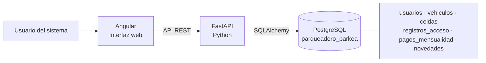

# PARKEA

Aplicación inicial de gestión de parqueadero con **Angular**, **FastAPI (Python)** y **PostgreSQL**. Incluye control de accesos con mensualidad vigente, mapa de celdas, usuarios y roles, vehículos, pagos e incidentes.

## Estructura

```text
parkea_app/
├── backend/                 # API FastAPI, modelos y autenticación
│   ├── scripts/              # Alta segura del primer administrador
│   ├── src/main.py           # Endpoints REST
│   ├── src/services/         # Reglas transaccionales de negocio
│   └── test/
├── database/schema.sql       # Esquema PostgreSQL e inicialización de celdas
├── frontend/                 # Aplicación Angular
└── docker-compose.yml        # PostgreSQL 16 para desarrollo local
```

## Arquitectura



## Requisitos

- Git.
- Python 3.11 o superior.
- Node.js 24.15 o superior (o 22.22.3 o superior) y npm.
- Docker Desktop iniciado, con Docker Compose.

## Clonar y ejecutar en Windows

Los pasos siguientes crean una base de desarrollo independiente en el computador de quien clone el repositorio. No necesitan tu archivo `.env`, tu base `Datasistempark` ni tus credenciales.

Abre PowerShell y ejecuta:

```powershell
git clone https://github.com/jdcpa1978-IUD/parkea.git
Set-Location parkea
```

### 1. Iniciar la base de datos local

Desde la carpeta `parkea`:

```powershell
docker compose up -d postgres
docker compose ps
```

Espera a que el servicio `postgres` aparezca como `healthy`. En la primera ejecución Docker crea la base `parqueadero_parkea`, aplica `database\schema.sql` y genera las 150 celdas de ejemplo. El usuario y la contraseña configurados en `docker-compose.yml` son exclusivamente para desarrollo local, no para producción. Docker conserva los datos en un volumen local; cada clon usa su propia base.

Si ya habías iniciado PostgreSQL con una versión anterior del proyecto, cambiar `POSTGRES_DB` no renombra la base dentro del volumen existente. Haz una copia de seguridad antes de crear o migrar datos a `parqueadero_parkea`; no elimines el volumen para forzar la inicialización si necesitas conservar información.

### 2. Configurar e iniciar la API

En la carpeta `parkea`, crea la configuración local y una clave secreta de desarrollo:

```powershell
Copy-Item backend\.env.example backend\.env
$jwtKey = py -c "import secrets; print(secrets.token_urlsafe(48))"
(Get-Content backend\.env) -replace '^JWT_SECRET_KEY=.*$', "JWT_SECRET_KEY=$jwtKey" | Set-Content backend\.env
Set-Location backend
py -m venv .venv
.\.venv\Scripts\python.exe -m pip install -r requirements.txt
.\.venv\Scripts\python.exe -m uvicorn src.main:app --reload
```

La API se sirve en `http://localhost:8000`; comprueba su documentación interactiva en `http://localhost:8000/docs`.

### 3. Crear el administrador inicial

Abre otra ventana de PowerShell, navega a la carpeta clonada y ejecuta:

```powershell
Set-Location backend
.\.venv\Scripts\python.exe scripts\create_admin.py
```

El comando solicita documento, nombre y contraseña sin mostrarla. Solo permite crear el primer administrador.

### 4. Arrancar Angular

Abre una tercera ventana de PowerShell y, desde la carpeta clonada, ejecuta:

```powershell
Set-Location frontend
npm ci
npm start
```

Abre `http://localhost:4200` e inicia sesión con el administrador. Desde la aplicación puedes registrar operadores, clientes, vehículos, celdas, mensualidades e incidentes. En **Vehículos**, puedes asociar un cliente existente o registrar en una transacción un cliente con su vehículo. El alta conjunta solicita documento y nombre completo; genera una contraseña inicial aleatoria y se la muestra al administrador una sola vez para compartirla con el cliente.

Para apagar PostgreSQL, ejecuta `docker compose stop postgres` desde la carpeta clonada. Para iniciar de nuevo, usa `docker compose start postgres`. Los datos se conservan en el volumen local.

### Usar otra instancia PostgreSQL

Si no quieres usar Docker, crea una base PostgreSQL vacía llamada `parqueadero_parkea`, ejecuta `database\schema.sql` una sola vez y configura `DATABASE_URL` en `backend\.env` con la dirección de esa base. No ejecutes el esquema inicial sobre una base que ya tenga las tablas de PARKEA. Si vas a conectar una base existente como `Datasistempark`, primero realiza una copia de seguridad y aplica una sola vez `database\migrations\001_align_existing_schema.sql` desde **Query Tool** en pgAdmin; esa base existente conserva su nombre. La migración interpreta las fechas previas como hora local de Bogotá. No compartas ni subas el `.env` ni credenciales de una base real.

## Roles y operaciones

- **Administrador:** administra usuarios, vehículos y celdas; consulta y opera todas las funciones.
- **Operador:** registra entradas y salidas, consulta celdas, registra pagos y novedades.
- **Cliente:** consulta sus vehículos, sus pagos y sus accesos; el resto de clientes y las operaciones internas quedan restringidos.

Para una entrada, la API valida cliente activo y mensualidad vigente, bloquea el vehículo y la plaza durante la transacción y registra el ingreso. La salida finaliza la estancia y libera la plaza en la misma transacción. Las mensualidades se encadenan desde el vencimiento vigente y ajustan el último día a la longitud real del mes. Índices únicos parciales impiden más de un ingreso activo por vehículo o celda.

## API principal

| Método | Ruta | Acceso |
|---|---|---|
| POST | `/api/auth/login` | Público |
| GET | `/api/auth/me` | Autenticado |
| GET | `/api/dashboard` | Autenticado |
| GET / POST / PATCH / DELETE | `/api/usuarios` | Administrador |
| GET | `/api/clientes` | Administrador u operador |
| GET / POST | `/api/vehiculos` | Lectura según rol; alta administrador |
| GET / POST / PATCH | `/api/celdas` | Lectura autenticada; cambios administrador |
| POST | `/api/accesos/entrada` | Administrador u operador |
| POST | `/api/accesos/salida` | Administrador u operador |
| GET | `/api/accesos/activos` | Consulta autenticada, limitada al propio cliente |
| GET / POST | `/api/pagos` | Lectura propia o de operación; alta administrador u operador |
| GET / POST | `/api/novedades` | Administrador u operador |

Las búsquedas exactas por placa usan un índice. La placa acepta únicamente de 1 a 6 caracteres alfanuméricos y se normaliza a mayúsculas tanto en la interfaz como en la API. La API devuelve errores de validación y conflictos con códigos HTTP explícitos.

## Pruebas

```powershell
Set-Location backend
.\.venv\Scripts\python.exe -m unittest discover -s test -v
Set-Location ..\frontend
npm ci
npm run build
```

## Solución de problemas

- Si el puerto `5432` ya está ocupado, detén el otro servicio PostgreSQL o cambia el puerto publicado en `docker-compose.yml` y el puerto de `DATABASE_URL` en `backend\.env` para que coincidan.
- Si `docker compose` no responde, inicia Docker Desktop y espera a que termine de cargar.
- Si la API no inicia, comprueba que PostgreSQL esté `healthy` y que el archivo `backend\.env` exista y tenga una clave `JWT_SECRET_KEY` generada localmente.
- Si `npm ci` falla, comprueba la versión de Node.js con `node --version` y utiliza una de las versiones indicadas arriba.

## Notas antes de producción

Configura `DATABASE_URL`, `JWT_SECRET_KEY` (mínimo 32 bytes) y `CORS_ORIGINS` según el entorno. No publiques el `.env` ni uses las credenciales de desarrollo de Docker en producción. Despliega detrás de HTTPS, añade migraciones versionadas, copias de seguridad y auditoría, y mueve la sesión del navegador a cookies `HttpOnly`, `Secure` y `SameSite` antes de manejar información real de clientes.
